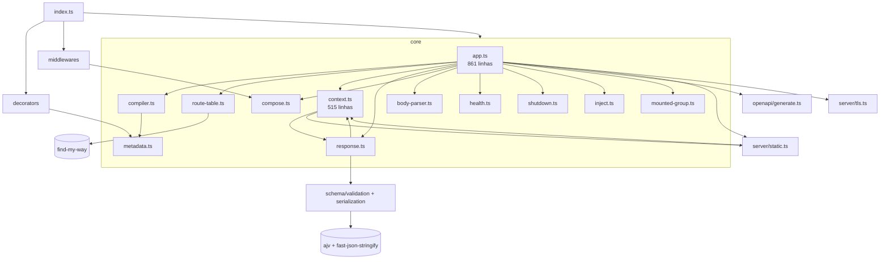
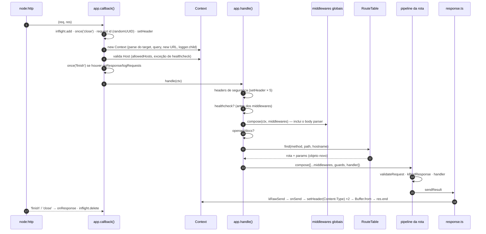
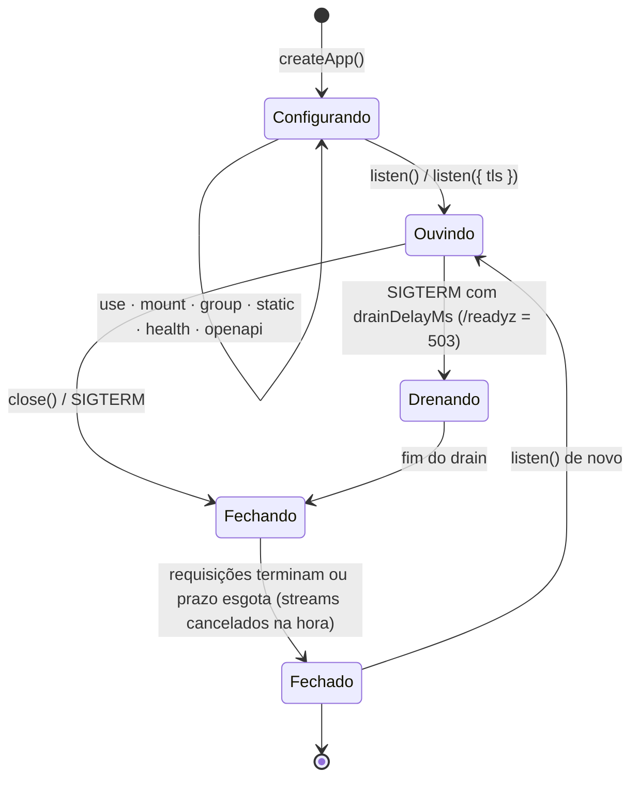
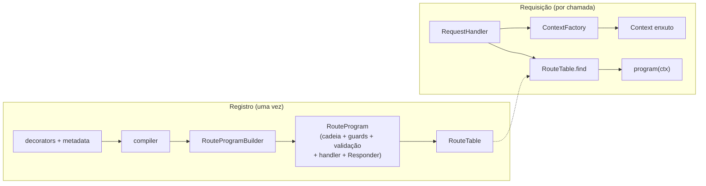

# Arquitetura do Sashiko

> **Estado:** retrato da versão **0.12.2** e a [estrutura proposta](#estrutura-proposta) para a refatoração de desempenho. A estrutura proposta ainda **não foi implementada**; ela é aplicada fase a fase, conforme o [plano](#plano-em-fases).

## Princípios que a arquitetura precisa preservar

- **Composição explícita, sem container de DI:** `@Router` + `app.mount()` + `app.group()`.
- **Infraestrutura pronta e segura por padrão:** headers de segurança, limites, timeouts, validação de `Host`, CSRF, shutdown gracioso.
- **Poucas dependências de runtime** (cinco), e extensões por injeção (`logger: pino()`), não por plugins.
- **Erros de configuração aparecem no registro**, não na primeira requisição.

## Módulos

| Módulo                              | Responsabilidade                                                                                                                                               | Observação estrutural                                                                                |
| ----------------------------------- | -------------------------------------------------------------------------------------------------------------------------------------------------------------- | ---------------------------------------------------------------------------------------------------- |
| `core/app.ts`                       | Opções, registro de rotas (duas fases), `group`, `static`, `health`, `openapi`, `listen`/`close`/TLS, `callback()` e `handle()` da requisição, hooks, shutdown | **Concentra responsabilidades demais:** registro, servidor e pipeline da requisição no mesmo arquivo |
| `core/context.ts`                   | Estado da requisição, getters (`host`, `ip`, `protocol`, `cookies`, `signal`), envio (`json`/`send`/`text`/`sse`/`sendFile`), `onSend`                         | Mistura o **modelo da requisição** com **estratégias de envio** (SSE, arquivo)                       |
| `core/compiler.ts`                  | Transforma metadata de decorators em `CompiledRoute`, escopos de grupo, checagem de path e params                                                              | Já é o ponto natural para "compilar" o pipeline por rota                                             |
| `core/route-table.ts`               | Fachada sobre o find-my-way, com estratégia de host própria                                                                                                    |                                                                                                      |
| `core/response.ts`                  | Pipeline de resposta: status padrão, schema, negociação, serializadores, NDJSON, erros                                                                         | Decide o formato com `if`s a cada resposta                                                           |
| `core/compose.ts`                   | Execução de middlewares no estilo onion                                                                                                                        | Cria closures a cada chamada                                                                         |
| `server/static.ts`, `server/tls.ts` | Arquivos estáticos e HTTPS/SNI                                                                                                                                 | `static.ts` e `context.ts` se importam mutuamente                                                    |
| `middlewares/*`                     | CORS, CSRF, rate limit, auth, security headers                                                                                                                 | Funções independentes, bem isoladas                                                                  |
| `decorators/*`, `core/metadata.ts`  | Coleta de metadata (só no carregamento das classes)                                                                                                            | Fora do caminho quente                                                                               |

**Ciclos de importação:** `context ↔ response`, `context ↔ static` e `errors → context` (este só de tipo). Hoje funcionam, porque os símbolos são usados em tempo de chamada, mas são frágeis em qualquer reorganização.

## Dois tempos: registro e requisição

O desempenho de um framework depende de **quanto trabalho é feito uma vez, no registro, e quanto é refeito a cada requisição**.

| Feito **no registro** (uma vez)                         | Refeito **a cada requisição** (hoje)                                             |
| ------------------------------------------------------- | -------------------------------------------------------------------------------- |
| Compilar schemas (Ajv, fast-json-stringify)             | Montar o array do pipeline da rota (`[...route.middlewares]`)                    |
| Resolver prefixos, hosts, middlewares e guards por rota | Criar o middleware de guards (`guardsMiddleware(route.guards)`)                  |
| Validar path e params, checar conflitos                 | Criar as closures do `compose` (duas cadeias por requisição)                     |
| Montar a tabela de headers de segurança                 | Escrever cada header de segurança com `setHeader` (validação do Node em cada um) |
| Compilar as regras de host e origem                     | Validar o `Host` várias vezes (o getter `ctx.host` recalcula a cada acesso)      |
|                                                         | Decidir o formato da resposta (`Object.keys(response)`, `mediaType`)             |
|                                                         | Criar o logger filho, que **recompila o `Set` do redact**                        |

## Ciclo de vida da requisição

### Custo por requisição (`GET /` com `{ hello: 'world' }`)

Levantado por inspeção do código e confirmado pelo profile de CPU da primeira rodada do benchmark, em que o GC ficou com 13% do tempo e o `setHeader` com cerca de 4%, mais as validações de header do Node.

| #   | Etapa                | Trabalho e alocações                                                                                                                                                                                                                 | Necessário a cada requisição?                            |
| --- | -------------------- | ------------------------------------------------------------------------------------------------------------------------------------------------------------------------------------------------------------------------------------ | -------------------------------------------------------- |
| 1   | `callback()`         | `performance.now`, `inflight.add`, listener `close` com closure, closure `fail`                                                                                                                                                      | O rastreamento sim; as closures podem ser compartilhadas |
| 2   | Request id           | `randomUUID()` + `setHeader`                                                                                                                                                                                                         | O id sim; o custo do UUID pode ser reduzido              |
| 3   | `new Context`        | Objeto de opções, `parseRequestTarget` (**1º `URL`**), objeto da query, `ctx.url` (**2º `URL`**, mais um getter de `host` e de `protocol`), `logger.child` (**objeto e closures novos**; no logger padrão, também o `Set` do redact) | Não: `url`, `query` e `log` podem ser preguiçosos        |
| 4   | Validação do `Host`  | `ctx.host` (regex) + `ctx.hostname` (de novo) + `allowedHosts`                                                                                                                                                                       | Uma vez sim, mas hoje são **3 a 4 vezes** por requisição |
| 5   | Headers de segurança | 5 × `setHeader` (validação de nome e valor pelo Node)                                                                                                                                                                                | Os valores são fixos: dá para escrever de uma vez        |
| 6   | Middlewares globais  | `compose`: closure `dispatch` + `async` por camada. O **body parser** roda em todo GET só para checar o método                                                                                                                       | O body parser pode ser decidido por rota                 |
| 7   | Roteamento           | `find` + spread `{ ...store, params }` (objeto novo)                                                                                                                                                                                 | O objeto novo, não                                       |
| 8   | Pipeline da rota     | `[...route.middlewares]`, `guardsMiddleware(...)` novo, closure do handler, segundo `compose`                                                                                                                                        | **Não:** é igual para toda requisição da rota            |
| 9   | Validação e envio    | `kBindResponse` (objeto novo), `Object.keys(response)`, `mediaType`, `setHeader(Content-Type)` duas vezes, `Buffer.from` (cópia), loop do `onSend`                                                                                   | A decisão de formato pode ser pré-compilada por rota     |

## Ciclo de vida do app

## Invariantes que a refatoração não pode quebrar

Os 393 testes garantem estes comportamentos. A refatoração precisa preservá-los todos, e o benchmark não substitui os testes.

| Garantia                                                                                                                  | Onde está testada                                                                                             |
| ------------------------------------------------------------------------------------------------------------------------- | ------------------------------------------------------------------------------------------------------------- |
| `Host` inválido, ou fora do `allowedHosts`, recebe 400 **antes** de qualquer middleware; healthchecks são a exceção       | `test/security/host-and-proxy.test.ts`, `test/features/integration-edges.test.ts`                             |
| Headers de segurança presentes em **toda** resposta, inclusive erros e 404                                                | `test/security/http-security.test.ts`                                                                         |
| Ordem: middlewares globais → (rota) middlewares → guards → validação → handler. Guards antes da validação                 | `test/features/route-middlewares.test.ts`, `test/features/route-groups.test.ts`                               |
| Um único pipeline de resposta para `return`, `ctx.json/send/text`, com schema, filtro de campos e negociação              | `test/features/response-pipeline.test.ts`, `test/features/response-formats.test.ts`                           |
| `onSend` em toda resposta com corpo (exceto streams), inclusive erros; `sentBody`/`sentType` preenchidos                  | `test/features/hooks.test.ts`                                                                                 |
| `onResponse`/`logRequests` uma vez por resposta, inclusive no `inject()`                                                  | `test/features/hooks.test.ts`, `test/features/integration-edges.test.ts`                                      |
| Erros em Problem Details; 5xx sem detalhes; `formatError`                                                                 | `test/features/problem-details.test.ts`, `test/core/errors.test.ts`                                           |
| 405 com `Allow` e OPTIONS automático, por host; HEAD usa o GET                                                            | `test/features/virtual-hosts.test.ts`, `test/features/vhost-consolidation.test.ts`                            |
| Registro em duas fases e atômico (mount, lista de hosts, group, aninhados, async)                                         | `test/features/vhost-consolidation.test.ts`                                                                   |
| `ctx.signal`: desconexão, inclusive antes do primeiro acesso; não cancela em resposta concluída (inclusive no `inject()`) | `test/features/streaming.test.ts`                                                                             |
| Shutdown gracioso: drain, streams cancelados primeiro, `close()` com prazo, listeners de sinal compartilhados             | `test/features/shutdown.test.ts`, `test/features/deploy-readiness.test.ts`, `test/features/streaming.test.ts` |
| Body JSON: limite, prototype pollution, JSON inválido                                                                     | `test/security/hardening.test.ts`, `test/core/errors.test.ts`                                                 |
| Request id: reaproveitado só se seguro; gerado senão                                                                      | `test/features/logger.test.ts`                                                                                |
| Logs com redact                                                                                                           | `test/security/hardening.test.ts`                                                                             |

**Garantias que não estão nos testes e precisam entrar antes de otimizar:**

1. Isolamento entre requisições: nenhum estado de um `Context` vaza para outro. É o risco principal de qualquer reaproveitamento de objetos.
2. Os headers de segurança continuam **sobrescrevíveis** por middleware ou handler, por exemplo a CSP própria do `/docs`.
3. Um middleware que lê `ctx.url`, `ctx.query` ou `ctx.log` em qualquer momento continua recebendo o mesmo valor, se esses campos passarem a ser preguiçosos.
4. Headers de segurança também no preflight CORS e no 400 de `Host` inválido. Hoje funcionam, mas não têm teste.
5. O body JSON já está lido quando os **middlewares globais** rodam (o body parser é o primeiro `use()`). Um middleware de auditoria pode depender disso.

## Desempenho: ponto de partida

Primeira rodada de [`sashiko-benchmarks`](https://github.com/code-cfernandes/sashiko-benchmarks) (Node 26, i7-13700H, WSL2, uma rodada; ordem de grandeza, não valor final):

| Perfil `defaults`  | `get` (req/s) | % do `node:http` |   RSS pico |
| ------------------ | ------------: | ---------------: | ---------: |
| `node:http`        |       153.856 |             100% |     116 MB |
| Fastify            |       141.466 |              92% |     122 MB |
| Express            |        60.476 |              39% |     132 MB |
| **Sashiko 0.12.2** |    **55.664** |          **36%** | **225 MB** |

O benchmark usa `logger: false`. O custo do logger padrão (etapa 3 da tabela de custo por requisição) não está nesses números.

## Estrutura proposta

### Ideia central: compilar no registro, executar o mínimo na requisição

Hoje cada requisição remonta o pipeline da rota, recalcula o host, cria o logger e decide o formato da resposta. A estrutura proposta move tudo que é igual para todas as requisições de uma rota para o **registro**, onde cada rota vira um **programa** pronto. A requisição só executa esse programa.

### Nova divisão de módulos

A API pública **não muda**: `createApp`, `SashikoApp`, `Context` e os tipos exportados continuam iguais. A divisão é interna.

| Hoje                           | Proposta                                                            | Responsabilidade                                                                                                                  |
| ------------------------------ | ------------------------------------------------------------------- | --------------------------------------------------------------------------------------------------------------------------------- |
| `core/app.ts` (861 linhas)     | `core/app.ts` (**Facade**)                                          | Só a API pública: `use`, `mount`, `group`, `static`, `health`, `openapi`, `listen`, `close`, hooks. Delega para os módulos abaixo |
|                                | `core/registry/registry.ts`                                         | Registro em duas fases (stage/commit), conflitos, paths reservados, `unreachableHosts`                                            |
|                                | `core/registry/route-program.ts` (**Builder**)                      | Compila cada rota num `RouteProgram`                                                                                              |
|                                | `core/runtime/request-handler.ts`                                   | O antigo `callback()` e `handle()`: rastreamento, request id, `Host`, headers de segurança, roteamento, erros                     |
|                                | `core/runtime/chain.ts` (**Chain of Responsibility pré-compilada**) | Substitui o `compose` por cadeias montadas no registro                                                                            |
|                                | `core/runtime/server.ts`                                            | `listen`, `close`, TLS, drain, shutdown                                                                                           |
| `core/context.ts` (515 linhas) | `core/context.ts`                                                   | Só o modelo da requisição, com campos preguiçosos e memoizados (**Proxy virtual**)                                                |
|                                | `core/context-factory.ts` (**Factory** + **Flyweight**)             | Cria o `Context` com um único objeto de configuração compartilhado pelo app                                                       |
|                                | `core/streaming/sse.ts`                                             | `ctx.sse()` sai do `Context`, que passa a só delegar                                                                              |
| `core/response.ts`             | `core/response/responders.ts` (**Strategy**)                        | Uma estratégia por formato (JSON com schema, JSON, texto, bytes, stream, NDJSON), escolhida no registro                           |
|                                | `core/response/raw-send.ts`                                         | Escrita final (`onSend`, `sentBody`), o único ponto que escreve o corpo                                                           |

**Ciclos de importação:** a divisão quebra os três atuais. O `Context` deixa de importar `response` e `static`: quem envia recebe o contexto, e não o contrário.

### Patterns aplicados, cada um ligado a um problema

Os problemas P-1 a P-11 vêm da tabela **Custo por requisição**, acima, e do profile do benchmark.

| Pattern                                      | Tipo           | Onde                                                                                                                                                           | Resolve                                      |
| -------------------------------------------- | -------------- | -------------------------------------------------------------------------------------------------------------------------------------------------------------- | -------------------------------------------- |
| **Builder**                                  | Criacional     | `RouteProgramBuilder` monta, no registro, a função completa de cada rota                                                                                       | P-5, P-8                                     |
| **Factory**                                  | Criacional     | `ContextFactory`: um ponto único de criação do `Context`, sem o objeto de opções por requisição                                                                | P-11 (parte), base do P-1 a P-3              |
| **Flyweight**                                | Estrutural     | Configuração compartilhada: headers de segurança já validados (P-4), configuração do logger com o `Set` do redact compilado uma vez (P-1), opções do `Context` | P-1, P-4                                     |
| **Proxy virtual** (inicialização preguiçosa) | Estrutural     | `ctx.url`, `ctx.query` e `ctx.log` criados no primeiro acesso; `host`/`hostname` memoizados                                                                    | P-1, P-2, P-3                                |
| **Facade**                                   | Estrutural     | `SashikoApp` como fachada fina sobre registry, runtime e server                                                                                                | Acoplamento do `app.ts`                      |
| **Chain of Responsibility** (pré-compilada)  | Comportamental | `chain.ts`: cadeia montada no registro, com caminho direto quando não há middlewares                                                                           | P-5, P-6                                     |
| **Strategy**                                 | Comportamental | `Responder` por rota (formato, status padrão, serializador) e leitura do body sem camada de middleware                                                         | P-7, P-8                                     |
| **Observer**                                 | Comportamental | Os hooks (`onSend`, `onResponse`, `onError`) continuam assim; são a base do `instrument()` da F-38                                                             | Extensibilidade, sem custo quando não usados |

**Não aplicados, por decisão:**

- **Object Pool para o `Context`:** reaproveitar objetos de requisição pode vazar dados de uma requisição para outra.
- **Singleton:** quebraria os vários apps num mesmo processo, que hoje funcionam e têm teste.
- **Decorator (GoF) em volta do `Context`:** mais uma camada no caminho quente, sem problema medido que justifique.

### Riscos de regressão e como cada fase se protege

| Risco                                                                                     | Onde aparece                             | Proteção                                                                                                                                           |
| ----------------------------------------------------------------------------------------- | ---------------------------------------- | -------------------------------------------------------------------------------------------------------------------------------------------------- |
| Campo preguiçoso com valor diferente conforme o momento do acesso (`ctx.url`, `ctx.log`)  | Proxy virtual                            | Os valores dependem só da requisição e da configuração, que não mudam durante ela. Teste novo: o mesmo valor antes e depois dos middlewares        |
| Estado vazando entre requisições                                                          | Factory e Flyweight                      | Só configuração **imutável** é compartilhada; o estado por requisição continua no `Context`. Teste novo de isolamento com requisições concorrentes |
| Header de segurança deixando de ser sobrescrevível                                        | Flyweight dos headers                    | Continuar escrevendo antes do handler. Teste novo: middleware e handler sobrescrevendo a CSP                                                       |
| Ordem do pipeline alterada (guards antes da validação, middlewares globais antes da rota) | Builder e Chain                          | A ordem fica num único lugar (o Builder) e os testes de ordem já existem                                                                           |
| Body indisponível para middlewares globais                                                | Leitura do body sem camada de middleware | Continua sendo lido **antes** dos globais, só sem a camada extra. Teste novo (invariante 5)                                                        |
| `onSend`, `sentBody` ou status padrão divergindo entre formatos                           | Strategy de resposta                     | Todas as estratégias terminam no mesmo `raw-send`. Os testes do pipeline único já cobrem                                                           |
| `inject()` e hooks se comportando diferente da rede                                       | Reorganização do runtime                 | Os testes de `inject()` com `onResponse` e `signal` já existem                                                                                     |
| Ganho de desempenho que some com o logger padrão                                          | Benchmark usa `logger: false`            | Cenário novo no benchmark com `consoleLogger`                                                                                                      |

## Plano em fases

Cada fase é um commit (ou poucos), na branch `refactor/architecture-and-performance`, e só avança com **todos os testes passando** e o **benchmark antes e depois** registrado no commit.

| Fase                            | O que entra                                                                                                                                       | Problemas       | Resultado esperado                                                            |
| ------------------------------- | ------------------------------------------------------------------------------------------------------------------------------------------------- | --------------- | ----------------------------------------------------------------------------- |
| **0. Rede de segurança**        | Testes das cinco garantias que faltam; no benchmark, o cenário `get` com o logger padrão e uma linha de base com três rodadas                     | —               | Nenhuma mudança de desempenho. Serve de referência para todas as fases        |
| **1. Reorganização estrutural** | Facade, `registry/`, `runtime/`, `response/`, `streaming/sse.ts`; os ciclos de importação quebrados. **Só movimentação, sem mudar comportamento** | Acoplamento     | Desempenho igual (o benchmark confirma); código pronto para as próximas fases |
| **2. Context enxuto**           | `ContextFactory`, campos preguiçosos e memoizados, Flyweight do logger                                                                            | P-1, P-2, P-3   | Menos alocação e GC; o maior ganho com o logger padrão                        |
| **3. Programa por rota**        | `RouteProgramBuilder`, cadeia pré-compilada, `Responder` por rota, `find()` sem spread, body sem camada de middleware                             | P-5 a P-9       | Maior ganho em `params`, `real` e `post-validate`                             |
| **4. Bordas da resposta**       | Headers de segurança em Flyweight, request id mais barato, listeners compartilhados no `callback()`                                               | P-4, P-10, P-11 | Ganho no `get` e na memória                                                   |
| **5. Fechamento**               | Benchmark final (três rodadas), `docs/ARCHITECTURE.md` atualizado com a estrutura implementada, CHANGELOG e PR                                    | —               | As metas da F-39, ou a justificativa documentada para cada uma não atingida   |
