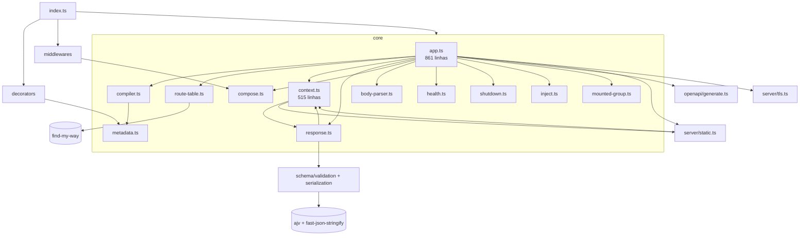
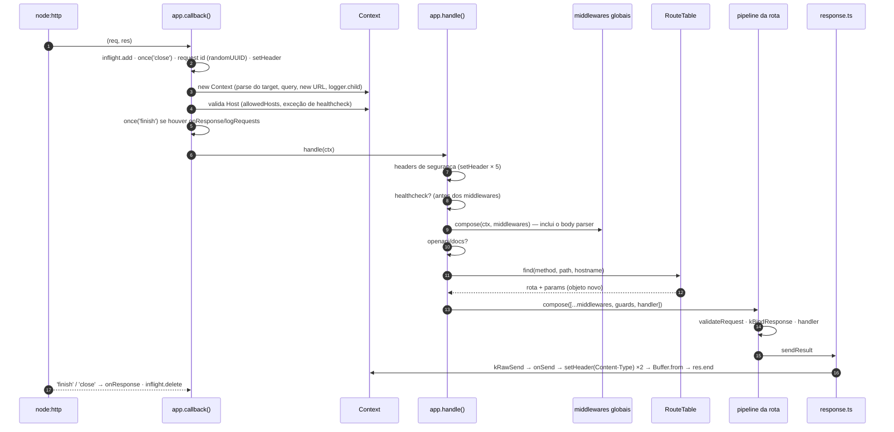
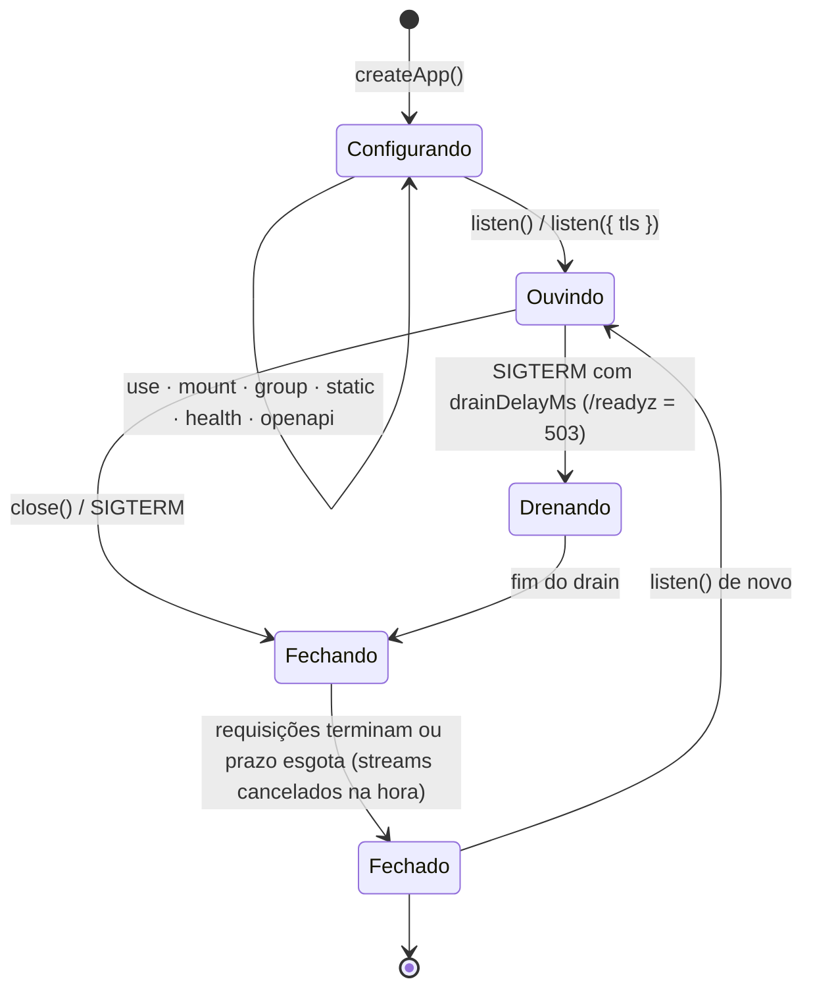

# Arquitetura do Sashiko

> **Estado:** retrato da versão **0.12.2**, feito para orientar a refatoração de desempenho (veja [Desempenho](#desempenho-ponto-de-partida)). A estrutura proposta entra neste documento numa etapa seguinte, depois de revisada.

## Princípios que a arquitetura precisa preservar

- **Composição explícita, sem container de DI:** `@Router` + `app.mount()` + `app.group()`.
- **Infraestrutura pronta e segura por padrão:** headers de segurança, limites, timeouts, validação de `Host`, CSRF, shutdown gracioso.
- **Poucas dependências de runtime** (cinco), e extensões por injeção (`logger: pino()`), não por plugins.
- **Erros de configuração aparecem no registro**, não na primeira requisição.

## Módulos

| Módulo                              | Responsabilidade                                                                                                                                               | Observação estrutural                                                                                |
| ----------------------------------- | -------------------------------------------------------------------------------------------------------------------------------------------------------------- | ---------------------------------------------------------------------------------------------------- |
| `core/app.ts`                       | Opções, registro de rotas (duas fases), `group`, `static`, `health`, `openapi`, `listen`/`close`/TLS, `callback()` e `handle()` da requisição, hooks, shutdown | **Concentra responsabilidades demais:** registro, servidor e pipeline da requisição no mesmo arquivo |
| `core/context.ts`                   | Estado da requisição, getters (`host`, `ip`, `protocol`, `cookies`, `signal`), envio (`json`/`send`/`text`/`sse`/`sendFile`), `onSend`                         | Mistura o **modelo da requisição** com **estratégias de envio** (SSE, arquivo)                       |
| `core/compiler.ts`                  | Transforma metadata de decorators em `CompiledRoute`, escopos de grupo, checagem de path e params                                                              | Já é o ponto natural para "compilar" o pipeline por rota                                             |
| `core/route-table.ts`               | Fachada sobre o find-my-way, com estratégia de host própria                                                                                                    |                                                                                                      |
| `core/response.ts`                  | Pipeline de resposta: status padrão, schema, negociação, serializadores, NDJSON, erros                                                                         | Decide o formato com `if`s a cada resposta                                                           |
| `core/compose.ts`                   | Execução de middlewares no estilo onion                                                                                                                        | Cria closures a cada chamada                                                                         |
| `server/static.ts`, `server/tls.ts` | Arquivos estáticos e HTTPS/SNI                                                                                                                                 | `static.ts` e `context.ts` se importam mutuamente                                                    |
| `middlewares/*`                     | CORS, CSRF, rate limit, auth, security headers                                                                                                                 | Funções independentes, bem isoladas                                                                  |
| `decorators/*`, `core/metadata.ts`  | Coleta de metadata (só no carregamento das classes)                                                                                                            | Fora do caminho quente                                                                               |

**Ciclos de importação:** `context ↔ response`, `context ↔ static` e `errors → context` (este só de tipo). Hoje funcionam, porque os símbolos são usados em tempo de chamada, mas são frágeis em qualquer reorganização.

## Dois tempos: registro e requisição

O desempenho de um framework depende de **quanto trabalho é feito uma vez, no registro, e quanto é refeito a cada requisição**.

| Feito **no registro** (uma vez)                         | Refeito **a cada requisição** (hoje)                                             |
| ------------------------------------------------------- | -------------------------------------------------------------------------------- |
| Compilar schemas (Ajv, fast-json-stringify)             | Montar o array do pipeline da rota (`[...route.middlewares]`)                    |
| Resolver prefixos, hosts, middlewares e guards por rota | Criar o middleware de guards (`guardsMiddleware(route.guards)`)                  |
| Validar path e params, checar conflitos                 | Criar as closures do `compose` (duas cadeias por requisição)                     |
| Montar a tabela de headers de segurança                 | Escrever cada header de segurança com `setHeader` (validação do Node em cada um) |
| Compilar as regras de host e origem                     | Validar o `Host` várias vezes (o getter `ctx.host` recalcula a cada acesso)      |
|                                                         | Decidir o formato da resposta (`Object.keys(response)`, `mediaType`)             |
|                                                         | Criar o logger filho, que **recompila o `Set` do redact**                        |

## Ciclo de vida da requisição

### Custo por requisição (`GET /` com `{ hello: 'world' }`)

Levantado por inspeção do código e confirmado pelo profile de CPU da primeira rodada do benchmark, em que o GC ficou com 13% do tempo e o `setHeader` com cerca de 4%, mais as validações de header do Node.

| #   | Etapa                | Trabalho e alocações                                                                                                                                                                                                                 | Necessário a cada requisição?                            |
| --- | -------------------- | ------------------------------------------------------------------------------------------------------------------------------------------------------------------------------------------------------------------------------------ | -------------------------------------------------------- |
| 1   | `callback()`         | `performance.now`, `inflight.add`, listener `close` com closure, closure `fail`                                                                                                                                                      | O rastreamento sim; as closures podem ser compartilhadas |
| 2   | Request id           | `randomUUID()` + `setHeader`                                                                                                                                                                                                         | O id sim; o custo do UUID pode ser reduzido              |
| 3   | `new Context`        | Objeto de opções, `parseRequestTarget` (**1º `URL`**), objeto da query, `ctx.url` (**2º `URL`**, mais um getter de `host` e de `protocol`), `logger.child` (**objeto e closures novos**; no logger padrão, também o `Set` do redact) | Não: `url`, `query` e `log` podem ser preguiçosos        |
| 4   | Validação do `Host`  | `ctx.host` (regex) + `ctx.hostname` (de novo) + `allowedHosts`                                                                                                                                                                       | Uma vez sim, mas hoje são **3 a 4 vezes** por requisição |
| 5   | Headers de segurança | 5 × `setHeader` (validação de nome e valor pelo Node)                                                                                                                                                                                | Os valores são fixos: dá para escrever de uma vez        |
| 6   | Middlewares globais  | `compose`: closure `dispatch` + `async` por camada. O **body parser** roda em todo GET só para checar o método                                                                                                                       | O body parser pode ser decidido por rota                 |
| 7   | Roteamento           | `find` + spread `{ ...store, params }` (objeto novo)                                                                                                                                                                                 | O objeto novo, não                                       |
| 8   | Pipeline da rota     | `[...route.middlewares]`, `guardsMiddleware(...)` novo, closure do handler, segundo `compose`                                                                                                                                        | **Não:** é igual para toda requisição da rota            |
| 9   | Validação e envio    | `kBindResponse` (objeto novo), `Object.keys(response)`, `mediaType`, `setHeader(Content-Type)` duas vezes, `Buffer.from` (cópia), loop do `onSend`                                                                                   | A decisão de formato pode ser pré-compilada por rota     |

## Ciclo de vida do app

## Invariantes que a refatoração não pode quebrar

Os 393 testes garantem estes comportamentos. A refatoração precisa preservá-los todos, e o benchmark não substitui os testes.

| Garantia                                                                                                                  | Onde está testada                                                                                             |
| ------------------------------------------------------------------------------------------------------------------------- | ------------------------------------------------------------------------------------------------------------- |
| `Host` inválido, ou fora do `allowedHosts`, recebe 400 **antes** de qualquer middleware; healthchecks são a exceção       | `test/security/host-and-proxy.test.ts`, `test/features/integration-edges.test.ts`                             |
| Headers de segurança presentes em **toda** resposta, inclusive erros e 404                                                | `test/security/http-security.test.ts`                                                                         |
| Ordem: middlewares globais → (rota) middlewares → guards → validação → handler. Guards antes da validação                 | `test/features/route-middlewares.test.ts`, `test/features/route-groups.test.ts`                               |
| Um único pipeline de resposta para `return`, `ctx.json/send/text`, com schema, filtro de campos e negociação              | `test/features/response-pipeline.test.ts`, `test/features/response-formats.test.ts`                           |
| `onSend` em toda resposta com corpo (exceto streams), inclusive erros; `sentBody`/`sentType` preenchidos                  | `test/features/hooks.test.ts`                                                                                 |
| `onResponse`/`logRequests` uma vez por resposta, inclusive no `inject()`                                                  | `test/features/hooks.test.ts`, `test/features/integration-edges.test.ts`                                      |
| Erros em Problem Details; 5xx sem detalhes; `formatError`                                                                 | `test/features/problem-details.test.ts`, `test/core/errors.test.ts`                                           |
| 405 com `Allow` e OPTIONS automático, por host; HEAD usa o GET                                                            | `test/features/virtual-hosts.test.ts`, `test/features/vhost-consolidation.test.ts`                            |
| Registro em duas fases e atômico (mount, lista de hosts, group, aninhados, async)                                         | `test/features/vhost-consolidation.test.ts`                                                                   |
| `ctx.signal`: desconexão, inclusive antes do primeiro acesso; não cancela em resposta concluída (inclusive no `inject()`) | `test/features/streaming.test.ts`                                                                             |
| Shutdown gracioso: drain, streams cancelados primeiro, `close()` com prazo, listeners de sinal compartilhados             | `test/features/shutdown.test.ts`, `test/features/deploy-readiness.test.ts`, `test/features/streaming.test.ts` |
| Body JSON: limite, prototype pollution, JSON inválido                                                                     | `test/security/hardening.test.ts`, `test/core/errors.test.ts`                                                 |
| Request id: reaproveitado só se seguro; gerado senão                                                                      | `test/features/logger.test.ts`                                                                                |
| Logs com redact                                                                                                           | `test/security/hardening.test.ts`                                                                             |

**Garantias que não estão nos testes e precisam entrar antes de otimizar:**

1. Isolamento entre requisições: nenhum estado de um `Context` vaza para outro. É o risco principal de qualquer reaproveitamento de objetos.
2. Os headers de segurança continuam **sobrescrevíveis** por middleware ou handler, por exemplo a CSP própria do `/docs`.
3. Um middleware que lê `ctx.url`, `ctx.query` ou `ctx.log` em qualquer momento continua recebendo o mesmo valor, se esses campos passarem a ser preguiçosos.
4. Headers de segurança também no preflight CORS e no 400 de `Host` inválido. Hoje funcionam, mas não têm teste.

## Desempenho: ponto de partida

Primeira rodada de [`sashiko-benchmarks`](https://github.com/code-cfernandes/sashiko-benchmarks) (Node 26, i7-13700H, WSL2, uma rodada; ordem de grandeza, não valor final):

| Perfil `defaults`  | `get` (req/s) | % do `node:http` |   RSS pico |
| ------------------ | ------------: | ---------------: | ---------: |
| `node:http`        |       153.856 |             100% |     116 MB |
| Fastify            |       141.466 |              92% |     122 MB |
| Express            |        60.476 |              39% |     132 MB |
| **Sashiko 0.12.2** |    **55.664** |          **36%** | **225 MB** |

O benchmark usa `logger: false`. O custo do logger padrão (etapa 3 da tabela de custo por requisição) não está nesses números.
