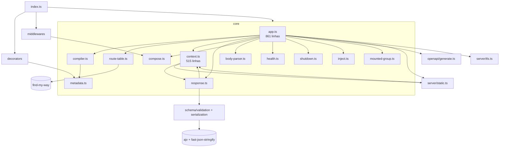
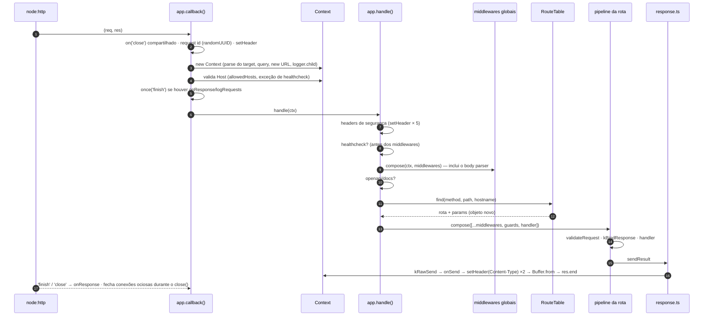
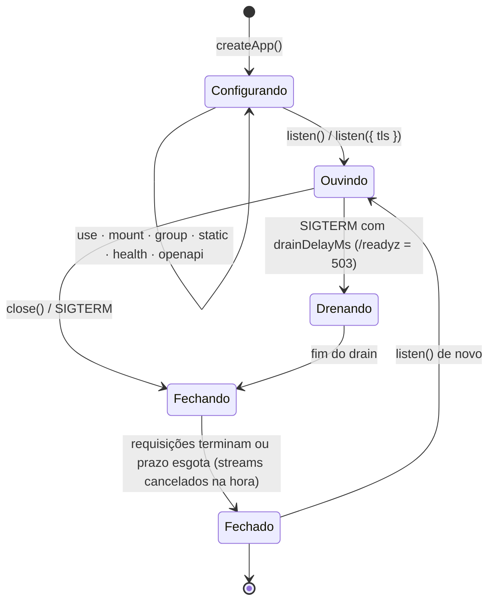
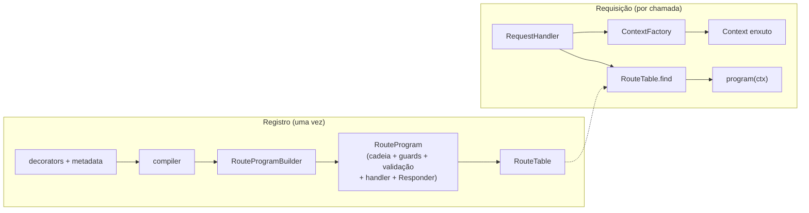
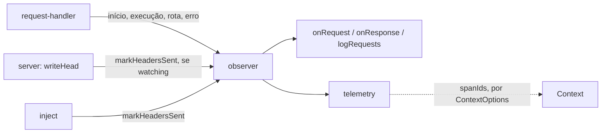

# Arquitetura do Sashiko

> **Estado:** as seções até "Plano em fases" são o retrato da versão **0.12.2** e a proposta feita antes da refatoração, mantidas como registro. O que foi implementado de fato, o que ficou de fora e os resultados medidos estão em [Estrutura implementada](#estrutura-implementada).

## Princípios que a arquitetura precisa preservar

- **Composição explícita, sem container de DI:** `@Router` + `app.mount()` + `app.group()`.
- **Infraestrutura pronta e segura por padrão:** headers de segurança, limites, timeouts, validação de `Host`, CSRF, shutdown gracioso.
- **Poucas dependências de runtime** (cinco), e extensões por injeção (`logger: pino()`), não por plugins.
- **Erros de configuração aparecem no registro**, não na primeira requisição.

## Módulos

| Módulo                              | Responsabilidade                                                                                                                                               | Observação estrutural                                                                                |
| ----------------------------------- | -------------------------------------------------------------------------------------------------------------------------------------------------------------- | ---------------------------------------------------------------------------------------------------- |
| `core/app.ts`                       | Opções, registro de rotas (duas fases), `group`, `static`, `health`, `openapi`, `listen`/`close`/TLS, `callback()` e `handle()` da requisição, hooks, shutdown | **Concentra responsabilidades demais:** registro, servidor e pipeline da requisição no mesmo arquivo |
| `core/context.ts`                   | Estado da requisição, getters (`host`, `ip`, `protocol`, `cookies`, `signal`), envio (`json`/`send`/`text`/`sse`/`sendFile`), `onSend`                         | Mistura o **modelo da requisição** com **estratégias de envio** (SSE, arquivo)                       |
| `core/compiler.ts`                  | Transforma metadata de decorators em `CompiledRoute`, escopos de grupo, checagem de path e params                                                              | Já é o ponto natural para "compilar" o pipeline por rota                                             |
| `core/route-table.ts`               | Fachada sobre o find-my-way, com estratégia de host própria                                                                                                    |                                                                                                      |
| `core/response.ts`                  | Pipeline de resposta: status padrão, schema, negociação, serializadores, NDJSON, erros                                                                         | Decide o formato com `if`s a cada resposta                                                           |
| `core/compose.ts`                   | Execução de middlewares no estilo onion                                                                                                                        | Cria closures a cada chamada                                                                         |
| `server/static.ts`, `server/tls.ts` | Arquivos estáticos e HTTPS/SNI                                                                                                                                 | `static.ts` e `context.ts` se importam mutuamente                                                    |
| `middlewares/*`                     | CORS, CSRF, rate limit, auth, security headers                                                                                                                 | Funções independentes, bem isoladas                                                                  |
| `decorators/*`, `core/metadata.ts`  | Coleta de metadata (só no carregamento das classes)                                                                                                            | Fora do caminho quente                                                                               |

**Ciclos de importação:** `context ↔ response`, `context ↔ static` e `errors → context` (este só de tipo). Hoje funcionam, porque os símbolos são usados em tempo de chamada, mas são frágeis em qualquer reorganização.

## Dois tempos: registro e requisição

O desempenho de um framework depende de **quanto trabalho é feito uma vez, no registro, e quanto é refeito a cada requisição**.

| Feito **no registro** (uma vez)                         | Refeito **a cada requisição** (hoje)                                             |
| ------------------------------------------------------- | -------------------------------------------------------------------------------- |
| Compilar schemas (Ajv, fast-json-stringify)             | Montar o array do pipeline da rota (`[...route.middlewares]`)                    |
| Resolver prefixos, hosts, middlewares e guards por rota | Criar o middleware de guards (`guardsMiddleware(route.guards)`)                  |
| Validar path e params, checar conflitos                 | Criar as closures do `compose` (duas cadeias por requisição)                     |
| Montar a tabela de headers de segurança                 | Escrever cada header de segurança com `setHeader` (validação do Node em cada um) |
| Compilar as regras de host e origem                     | Validar o `Host` várias vezes (o getter `ctx.host` recalcula a cada acesso)      |
|                                                         | Decidir o formato da resposta (`Object.keys(response)`, `mediaType`)             |
|                                                         | Criar o logger filho, que **recompila o `Set` do redact**                        |

## Ciclo de vida da requisição

### Custo por requisição (`GET /` com `{ hello: 'world' }`)

Levantado por inspeção do código e confirmado pelo profile de CPU da primeira rodada do benchmark, em que o GC ficou com 13% do tempo e o `setHeader` com cerca de 4%, mais as validações de header do Node.

| #   | Etapa                | Trabalho e alocações                                                                                                                                                                                                                 | Necessário a cada requisição?                            |
| --- | -------------------- | ------------------------------------------------------------------------------------------------------------------------------------------------------------------------------------------------------------------------------------ | -------------------------------------------------------- |
| 1   | `callback()`         | `performance.now`, `inflight.add` (removido depois, ver “Memória”), listener `close` com closure, closure `fail`                                                                                                                     | O rastreamento sim; as closures podem ser compartilhadas |
| 2   | Request id           | `randomUUID()` + `setHeader`                                                                                                                                                                                                         | O id sim; o custo do UUID pode ser reduzido              |
| 3   | `new Context`        | Objeto de opções, `parseRequestTarget` (**1º `URL`**), objeto da query, `ctx.url` (**2º `URL`**, mais um getter de `host` e de `protocol`), `logger.child` (**objeto e closures novos**; no logger padrão, também o `Set` do redact) | Não: `url`, `query` e `log` podem ser preguiçosos        |
| 4   | Validação do `Host`  | `ctx.host` (regex) + `ctx.hostname` (de novo) + `allowedHosts`                                                                                                                                                                       | Uma vez sim, mas hoje são **3 a 4 vezes** por requisição |
| 5   | Headers de segurança | 5 × `setHeader` (validação de nome e valor pelo Node)                                                                                                                                                                                | Os valores são fixos: dá para escrever de uma vez        |
| 6   | Middlewares globais  | `compose`: closure `dispatch` + `async` por camada. O **body parser** roda em todo GET só para checar o método                                                                                                                       | O body parser pode ser decidido por rota                 |
| 7   | Roteamento           | `find` + spread `{ ...store, params }` (objeto novo)                                                                                                                                                                                 | O objeto novo, não                                       |
| 8   | Pipeline da rota     | `[...route.middlewares]`, `guardsMiddleware(...)` novo, closure do handler, segundo `compose`                                                                                                                                        | **Não:** é igual para toda requisição da rota            |
| 9   | Validação e envio    | `kBindResponse` (objeto novo), `Object.keys(response)`, `mediaType`, `setHeader(Content-Type)` duas vezes, `Buffer.from` (cópia), loop do `onSend`                                                                                   | A decisão de formato pode ser pré-compilada por rota     |

## Ciclo de vida do app

## Invariantes que a refatoração não pode quebrar

Os 393 testes garantem estes comportamentos. A refatoração precisa preservá-los todos, e o benchmark não substitui os testes.

| Garantia                                                                                                                  | Onde está testada                                                                                             |
| ------------------------------------------------------------------------------------------------------------------------- | ------------------------------------------------------------------------------------------------------------- |
| `Host` inválido, ou fora do `allowedHosts`, recebe 400 **antes** de qualquer middleware; healthchecks são a exceção       | `test/security/host-and-proxy.test.ts`, `test/features/integration-edges.test.ts`                             |
| Headers de segurança presentes em **toda** resposta, inclusive erros e 404                                                | `test/security/http-security.test.ts`                                                                         |
| Ordem: middlewares globais → (rota) middlewares → guards → validação → handler. Guards antes da validação                 | `test/features/route-middlewares.test.ts`, `test/features/route-groups.test.ts`                               |
| Um único pipeline de resposta para `return`, `ctx.json/send/text`, com schema, filtro de campos e negociação              | `test/features/response-pipeline.test.ts`, `test/features/response-formats.test.ts`                           |
| `onSend` em toda resposta com corpo (exceto streams), inclusive erros; `sentBody`/`sentType` preenchidos                  | `test/features/hooks.test.ts`                                                                                 |
| `onResponse`/`logRequests` uma vez por resposta, inclusive no `inject()`                                                  | `test/features/hooks.test.ts`, `test/features/integration-edges.test.ts`                                      |
| Erros em Problem Details; 5xx sem detalhes; `formatError`                                                                 | `test/features/problem-details.test.ts`, `test/core/errors.test.ts`                                           |
| 405 com `Allow` e OPTIONS automático, por host; HEAD usa o GET                                                            | `test/features/virtual-hosts.test.ts`, `test/features/vhost-consolidation.test.ts`                            |
| Registro em duas fases e atômico (mount, lista de hosts, group, aninhados, async)                                         | `test/features/vhost-consolidation.test.ts`                                                                   |
| `ctx.signal`: desconexão, inclusive antes do primeiro acesso; não cancela em resposta concluída (inclusive no `inject()`) | `test/features/streaming.test.ts`                                                                             |
| Shutdown gracioso: drain, streams cancelados primeiro, `close()` com prazo, listeners de sinal compartilhados             | `test/features/shutdown.test.ts`, `test/features/deploy-readiness.test.ts`, `test/features/streaming.test.ts` |
| Body JSON: limite, prototype pollution, JSON inválido                                                                     | `test/security/hardening.test.ts`, `test/core/errors.test.ts`                                                 |
| Request id: reaproveitado só se seguro; gerado senão                                                                      | `test/features/logger.test.ts`                                                                                |
| Logs com redact                                                                                                           | `test/security/hardening.test.ts`                                                                             |

**Garantias que não estão nos testes e precisam entrar antes de otimizar:**

1. Isolamento entre requisições: nenhum estado de um `Context` vaza para outro. É o risco principal de qualquer reaproveitamento de objetos.
2. Os headers de segurança continuam **sobrescrevíveis** por middleware ou handler, por exemplo a CSP própria do `/docs`.
3. Um middleware que lê `ctx.url`, `ctx.query` ou `ctx.log` em qualquer momento continua recebendo o mesmo valor, se esses campos passarem a ser preguiçosos.
4. Headers de segurança também no preflight CORS e no 400 de `Host` inválido. Hoje funcionam, mas não têm teste.
5. O body JSON já está lido quando os **middlewares globais** rodam (o body parser é o primeiro `use()`). Um middleware de auditoria pode depender disso.

## Desempenho: ponto de partida

Primeira rodada de [`sashiko-benchmarks`](https://github.com/code-cfernandes/sashiko-benchmarks) (Node 26, i7-13700H, WSL2, uma rodada; ordem de grandeza, não valor final):

| Perfil `defaults`  | `get` (req/s) | % do `node:http` |   RSS pico |
| ------------------ | ------------: | ---------------: | ---------: |
| `node:http`        |       153.856 |             100% |     116 MB |
| Fastify            |       141.466 |              92% |     122 MB |
| Express            |        60.476 |              39% |     132 MB |
| **Sashiko 0.12.2** |    **55.664** |          **36%** | **225 MB** |

Esta primeira rodada usou `logger: false`, então o custo do logger padrão (etapa 3 da tabela de custo por requisição) não está nesses números. A partir da fase 0, o benchmark usa a configuração padrão do Sashiko.

## Estrutura proposta

### Ideia central: compilar no registro, executar o mínimo na requisição

Hoje cada requisição remonta o pipeline da rota, recalcula o host, cria o logger e decide o formato da resposta. A estrutura proposta move tudo que é igual para todas as requisições de uma rota para o **registro**, onde cada rota vira um **programa** pronto. A requisição só executa esse programa.

### Nova divisão de módulos

A API pública **não muda**: `createApp`, `SashikoApp`, `Context` e os tipos exportados continuam iguais. A divisão é interna.

| Hoje                           | Proposta                                                            | Responsabilidade                                                                                                                  |
| ------------------------------ | ------------------------------------------------------------------- | --------------------------------------------------------------------------------------------------------------------------------- |
| `core/app.ts` (861 linhas)     | `core/app.ts` (**Facade**)                                          | Só a API pública: `use`, `mount`, `group`, `static`, `health`, `openapi`, `listen`, `close`, hooks. Delega para os módulos abaixo |
|                                | `core/registry/registry.ts`                                         | Registro em duas fases (stage/commit), conflitos, paths reservados, `unreachableHosts`                                            |
|                                | `core/registry/route-program.ts` (**Builder**)                      | Compila cada rota num `RouteProgram`                                                                                              |
|                                | `core/runtime/request-handler.ts`                                   | O antigo `callback()` e `handle()`: rastreamento, request id, `Host`, headers de segurança, roteamento, erros                     |
|                                | `core/runtime/chain.ts` (**Chain of Responsibility pré-compilada**) | Substitui o `compose` por cadeias montadas no registro                                                                            |
|                                | `core/runtime/server.ts`                                            | `listen`, `close`, TLS, drain, shutdown                                                                                           |
| `core/context.ts` (515 linhas) | `core/context.ts`                                                   | Só o modelo da requisição, com campos preguiçosos e memoizados (**Proxy virtual**)                                                |
|                                | `core/context-factory.ts` (**Factory** + **Flyweight**)             | Cria o `Context` com um único objeto de configuração compartilhado pelo app                                                       |
|                                | `core/streaming/sse.ts`                                             | `ctx.sse()` sai do `Context`, que passa a só delegar                                                                              |
| `core/response.ts`             | `core/response/responders.ts` (**Strategy**)                        | Uma estratégia por formato (JSON com schema, JSON, texto, bytes, stream, NDJSON), escolhida no registro                           |
|                                | `core/response/raw-send.ts`                                         | Escrita final (`onSend`, `sentBody`), o único ponto que escreve o corpo                                                           |

**Ciclos de importação:** a divisão quebra os três atuais. O `Context` deixa de importar `response` e `static`: quem envia recebe o contexto, e não o contrário.

### Patterns aplicados, cada um ligado a um problema

Os problemas P-1 a P-11 vêm da tabela **Custo por requisição**, acima, e do profile do benchmark.

| Pattern                                      | Tipo           | Onde                                                                                                                                                           | Resolve                                      |
| -------------------------------------------- | -------------- | -------------------------------------------------------------------------------------------------------------------------------------------------------------- | -------------------------------------------- |
| **Builder**                                  | Criacional     | `RouteProgramBuilder` monta, no registro, a função completa de cada rota                                                                                       | P-5, P-8                                     |
| **Factory**                                  | Criacional     | `ContextFactory`: um ponto único de criação do `Context`, sem o objeto de opções por requisição                                                                | P-11 (parte), base do P-1 a P-3              |
| **Flyweight**                                | Estrutural     | Configuração compartilhada: headers de segurança já validados (P-4), configuração do logger com o `Set` do redact compilado uma vez (P-1), opções do `Context` | P-1, P-4                                     |
| **Proxy virtual** (inicialização preguiçosa) | Estrutural     | `ctx.url`, `ctx.query` e `ctx.log` criados no primeiro acesso; `host`/`hostname` memoizados                                                                    | P-1, P-2, P-3                                |
| **Facade**                                   | Estrutural     | `SashikoApp` como fachada fina sobre registry, runtime e server                                                                                                | Acoplamento do `app.ts`                      |
| **Chain of Responsibility** (pré-compilada)  | Comportamental | `chain.ts`: cadeia montada no registro, com caminho direto quando não há middlewares                                                                           | P-5, P-6                                     |
| **Strategy**                                 | Comportamental | `Responder` por rota (formato, status padrão, serializador) e leitura do body sem camada de middleware                                                         | P-7, P-8                                     |
| **Observer**                                 | Comportamental | Os hooks (`onSend`, `onResponse`, `onError`) continuam assim; são a base do `instrument()` da F-38                                                             | Extensibilidade, sem custo quando não usados |

**Não aplicados, por decisão:**

- **Object Pool para o `Context`:** reaproveitar objetos de requisição pode vazar dados de uma requisição para outra.
- **Singleton:** quebraria os vários apps num mesmo processo, que hoje funcionam e têm teste.
- **Decorator (GoF) em volta do `Context`:** mais uma camada no caminho quente, sem problema medido que justifique.

### Riscos de regressão e como cada fase se protege

| Risco                                                                                     | Onde aparece                             | Proteção                                                                                                                                           |
| ----------------------------------------------------------------------------------------- | ---------------------------------------- | -------------------------------------------------------------------------------------------------------------------------------------------------- |
| Campo preguiçoso com valor diferente conforme o momento do acesso (`ctx.url`, `ctx.log`)  | Proxy virtual                            | Os valores dependem só da requisição e da configuração, que não mudam durante ela. Teste novo: o mesmo valor antes e depois dos middlewares        |
| Estado vazando entre requisições                                                          | Factory e Flyweight                      | Só configuração **imutável** é compartilhada; o estado por requisição continua no `Context`. Teste novo de isolamento com requisições concorrentes |
| Header de segurança deixando de ser sobrescrevível                                        | Flyweight dos headers                    | Continuar escrevendo antes do handler. Teste novo: middleware e handler sobrescrevendo a CSP                                                       |
| Ordem do pipeline alterada (guards antes da validação, middlewares globais antes da rota) | Builder e Chain                          | A ordem fica num único lugar (o Builder) e os testes de ordem já existem                                                                           |
| Body indisponível para middlewares globais                                                | Leitura do body sem camada de middleware | Continua sendo lido **antes** dos globais, só sem a camada extra. Teste novo (invariante 5)                                                        |
| `onSend`, `sentBody` ou status padrão divergindo entre formatos                           | Strategy de resposta                     | Todas as estratégias terminam no mesmo `raw-send`. Os testes do pipeline único já cobrem                                                           |
| `inject()` e hooks se comportando diferente da rede                                       | Reorganização do runtime                 | Os testes de `inject()` com `onResponse` e `signal` já existem                                                                                     |
| Ganho de desempenho que some com o logger padrão                                          | Benchmark usava `logger: false`          | O benchmark passou a usar a configuração padrão do Sashiko                                                                                         |

## Plano em fases

Cada fase é um commit (ou poucos), na branch `refactor/architecture-and-performance`, e só avança com **todos os testes passando** e o **benchmark antes e depois** registrado no commit.

| Fase                            | O que entra                                                                                                                                                | Problemas             | Resultado esperado                                                            |
| ------------------------------- | ---------------------------------------------------------------------------------------------------------------------------------------------------------- | --------------------- | ----------------------------------------------------------------------------- |
| **0. Rede de segurança**        | Testes das cinco garantias que faltam; o benchmark passa a rodar o Sashiko com o logger padrão e a medir o build local; uma linha de base com três rodadas | —                     | Nenhuma mudança de desempenho. Serve de referência para todas as fases        |
| **1. Reorganização estrutural** | Facade, `registry/`, `runtime/`, `response/`, `streaming/sse.ts`; os ciclos de importação quebrados. **Só movimentação, sem mudar comportamento**          | Acoplamento           | Desempenho igual (o benchmark confirma); código pronto para as próximas fases |
| **2. Context enxuto**           | `ContextFactory`, campos preguiçosos e memoizados, Flyweight do logger                                                                                     | P-1, P-2, P-3         | Menos alocação e GC; o maior ganho com o logger padrão                        |
| **3. Programa por rota**        | `RouteProgramBuilder`, cadeia pré-compilada, `Responder` por rota, `find()` sem spread, body sem camada de middleware                                      | P-5 a P-9             | Maior ganho em `params`, `real` e `post-validate`                             |
| **4. Bordas da resposta**       | Headers de segurança em Flyweight, request id mais barato, listeners compartilhados no `callback()`, desconexão do cliente fora do nível `error`           | P-4, P-10, P-11, P-12 | Ganho no `get` e na memória; logs limpos                                      |
| **5. Fechamento**               | Benchmark final (três rodadas), `docs/ARCHITECTURE.md` atualizado com a estrutura implementada, CHANGELOG e PR                                             | —                     | As metas da F-39, ou a justificativa documentada para cada uma não atingida   |

## Estrutura implementada

A refatoração seguiu o plano em fases, com todos os testes passando e o benchmark antes e depois de cada fase. As diferenças em relação à proposta estão na tabela abaixo.

### Módulos

| Módulo                                    |   Linhas | Responsabilidade                                                                                                   |
| ----------------------------------------- | -------: | ------------------------------------------------------------------------------------------------------------------ |
| `core/app.ts`                             |      327 | **Facade:** só a API pública, delegando para os módulos abaixo (era 861)                                           |
| `core/app/core.ts`, `core/app/options.ts` | 23 + 110 | Estado compartilhado (configuração e listas de hooks) e os tipos de opções                                         |
| `core/registry/registry.ts`               |      162 | Registro em duas fases, conflitos, paths reservados, `unreachableHosts`, `routesFor()`                             |
| `core/registry/framework-routes.ts`       |       94 | `health()` e `openapi()`: configuração, paths reservados e o envio do documento                                    |
| `core/registry/route-program.ts`          |       32 | **Builder:** monta, no registro, o programa de cada rota                                                           |
| `core/runtime/request-handler.ts`         |      196 | O pipeline da requisição: rastreamento, request id, `Host`, headers de segurança, cadeia global, roteamento, erros |
| `core/runtime/server.ts`                  |      154 | `listen`, `close`, TLS, drain, shutdown                                                                            |
| `core/context.ts`                         |      451 | O modelo da requisição, com campos preguiçosos e memoizados (era 515, com o SSE)                                   |
| `core/streaming/sse.ts`                   |      141 | `ctx.sse()`                                                                                                        |
| `core/response/pipeline.ts`               |      237 | Pipeline de resposta e o `ResponsePlan` por rota                                                                   |
| `core/compose.ts`                         |       41 | `compose` (healthchecks e OpenAPI) e `compileChain` (cadeias pré-compiladas)                                       |
| `core/symbols.ts`                         |       14 | Símbolos internos, fora do `Context`, para quebrar os ciclos de importação                                         |

Os três ciclos de importação foram quebrados: `response`, `static` e `health` dependem do `Context` só como tipo.

### Proposta × implementação

| Proposta                                            | O que foi feito                                                                                 | Por quê                                                                                                                                      |
| --------------------------------------------------- | ----------------------------------------------------------------------------------------------- | -------------------------------------------------------------------------------------------------------------------------------------------- |
| `runtime/chain.ts`                                  | `compileChain` em `core/compose.ts`                                                             | Uma função; não justificava um módulo                                                                                                        |
| `core/context-factory.ts`                           | Um objeto de opções por listener em `request-handler.ts`, e o `id` como parâmetro do construtor | O ganho estava em não criar o objeto por requisição; um módulo próprio não acrescentava nada                                                 |
| `response/responders.ts` (uma Strategy por formato) | `ResponsePlan` por rota (schemas, serializadores, status padrão) em `response/pipeline.ts`      | O profile não mostrou a escolha do formato como custo relevante; o que pesava eram o `Content-Type` duplo e a cópia do corpo                 |
| `response/raw-send.ts`                              | O envio cru continua em `Context[kRawSend]`                                                     | Mesmo motivo; o ponto único de escrita já existia                                                                                            |
| Flyweight dos headers de segurança (P-4)            | **Não feito**                                                                                   | A alternativa ao `setHeader` (`writeHead` com os headers) daria precedência ao padrão sobre o que o handler define, quebrando a invariante 2 |
| Request id mais barato (P-10)                       | **Não feito**                                                                                   | Cerca de 1,4% do tempo; trocar o UUID mudaria o formato que os usuários recebem                                                              |

### Correções de comportamento encontradas durante a refatoração

1. **Host validado é o host roteado (fase 2):** um middleware que reescrevia `req.headers.host` mudava o roteamento por virtual host e podia contornar o `allowedHosts`.
2. **Modelo onion dos middlewares globais (fase 3):** o código depois do `await next()` num `app.use()` rodava **antes** da rota, contradizendo o README.
3. **Cadeia interrompida (fase 3):** um middleware global que não chamava `next()` nem respondia deixava a rota rodar.

As três têm testes em `test/core/invariants.test.ts` e estão no CHANGELOG, com a migração.

### Resultados

Medidos com o [`sashiko-benchmarks`](https://github.com/code-cfernandes/sashiko-benchmarks): Node 26, i7-13700H, WSL2, autocannon com 100 conexões, pipelining 10, 10 s por medição, mediana de três rodadas, Sashiko com a configuração padrão (logger ligado). Rodada final em `results/final-f39.json`; a linha de base (0.12.2, mesmas condições) em `results/baseline-fase0.json`.

**Sashiko, 0.12.2 → refatoração (perfil `defaults`):**

| Cenário         | 0.12.2 (req/s) | Agora (req/s) |         Ganho | % do `node:http` | % do Fastify | Posição (de 6) |
| --------------- | -------------: | ------------: | ------------: | ---------------: | -----------: | -------------: |
| `get`           |         51.299 |        82.732 |    **+61,3%** |      33% → 55,5% |        54,7% |             5º |
| `params`        |         50.320 |        80.205 |    **+59,4%** |      33% → 54,0% |        55,1% |             5º |
| `post-validate` |         29.470 |        51.222 |    **+73,8%** |      31% → 52,2% |        67,5% |             4º |
| `real`          |         45.430 |        66.069 |    **+45,4%** |      36% → 51,5% |        58,9% |             4º |
| `static`        |          2.435 |         2.518 | +3,4% (ruído) |            96,9% |       104,4% |             4º |

**Perfil `equivalent`** (todos enviando os mesmos headers de segurança do Sashiko), em que a comparação é de trabalho igual:

| Cenário         | Sashiko (req/s) | % do `node:http` | % do Fastify | Posição (de 6) |
| --------------- | --------------: | ---------------: | -----------: | -------------: |
| `get`           |          80.992 |            69,6% |        88,1% |             3º |
| `params`        |          80.896 |            67,9% |        87,4% |             3º |
| `post-validate` |          50.055 |            60,6% |        92,9% |             3º |
| `real`          |          57.523 |            54,6% |        75,6% |             5º |

**Atribuição por fase** (cada fase medida contra a anterior, nas mesmas condições):

| Fase     | O que entrou                                   |         `get` |        `real` |
| -------- | ---------------------------------------------- | ------------: | ------------: |
| 1        | Reorganização estrutural                       |         ruído |         ruído |
| 2        | `Context` enxuto e logger compartilhado        |        +21,8% |        +19,8% |
| 3        | Programa por rota e cadeia pré-compilada       | −0,3% (ruído) | −1,1% (ruído) |
| 4 · P-11 | Callback sem closures                          |         +7,7% |         +6,7% |
| 4 · P-8  | `Content-Type` uma vez e `sentBody` preguiçoso |         +8,8% |         +7,5% |
| 4 · P-8  | `mediaType`/`withCharset` memoizados           |         +3,1% |         +3,6% |
| 4 · P-12 | Desconexão do cliente em `debug` (correção)    |         ruído |         ruído |

**Memória** (rodada de 3 min no `get`, com o diagnóstico dentro do processo, `results/longrun-*.json`):

|                           |      req/s | RSS de pico | Heap usado (pico) | Heap depois do GC |
| ------------------------- | ---------: | ----------: | ----------------: | ----------------: |
| `node:http`               |    155.533 |    143,9 MB |           39,6 MB |            9,9 MB |
| Fastify                   |    148.510 |    153,6 MB |           42,9 MB |           12,3 MB |
| Sashiko 0.12.2            |     53.283 |    227,4 MB |          101,1 MB |           12,8 MB |
| **Sashiko (refatoração)** | **84.048** |    224,7 MB |           95,3 MB |           11,4 MB |

Sem vazamento: o heap volta a cerca de 11 MB depois do GC, e a série a cada 5 s oscila sem tendência de alta.

### Metas da F-39

| Meta                                     | Resultado                                  | Situação               |
| ---------------------------------------- | ------------------------------------------ | ---------------------- |
| `get` em pelo menos 75% do `node:http`   | 55,5% (`defaults`), 69,6% (`equivalent`)   | **Não atingida**       |
| `real` e `post-validate` com 2× a 0.12.2 | 1,45× e 1,74×                              | **Não atingida**       |
| RSS de pico abaixo de 140 MB             | cerca de 225 MB; 124 MB na 0.14.0 (`get`)  | **Atingida na 0.14.0** |
| API pública preservada                   | Mesmos 39 exports; membros públicos iguais | Atingida               |
| Todos os testes passando em cada fase    | 409 testes                                 | Atingida               |

### Memória (0.14.0)

O RSS de pico não caiu com a refatoração porque a causa não era a alocação. Os experimentos, todos no `get`:

- **Headers de segurança desligados:** o pico cai só 2 a 10 MB.
- **Heap snapshot sob carga:** o Sashiko retém só cerca de 2 MB a mais que o `node:http`.
- **`--max-semi-space-size` menor:** o pico cai para 154 MB, mas a vazão cai cerca de 17%. Isso indicava objetos de vida curta sobrevivendo às coletas rápidas do V8.

A causa era o `Set` de respostas em andamento que o `close()` usava. Sendo um objeto de longa duração que aponta para cada resposta nova, ele fazia toda resposta (com `req`, parser e headers do Node) ser promovida para a old space. Sem ele, o `close()` mantém o comportamento:

- **Streams abertos:** só SSE, NDJSON e `Readable` entram num conjunto próprio, avisados pelo `Context`.
- **`Connection: close`:** os servidores criados pelo `listen()` usam uma subclasse de `ServerResponse` cujo `writeHead` desliga o keep-alive durante o encerramento.
- **Conexões ociosas:** o listener `close` compartilhado as fecha durante o `close()`.

Rodada final em `results/final-f41.json`, mesmas condições da seção anterior:

| Perfil `defaults` | req/s (0.13.0 → 0.14.0) | RSS de pico (MB) | % do `node:http` | % do Fastify |
| ----------------- | ----------------------: | ---------------: | ---------------: | -----------: |
| `get`             |        82.732 → 102.918 |    219,6 → 124,0 |            68,0% |        68,4% |
| `params`          |         80.205 → 97.555 |    222,4 → 125,3 |            65,8% |        67,6% |
| `post-validate`   |         51.222 → 56.060 |    231,6 → 140,9 |            58,1% |        70,8% |
| `real`            |         66.069 → 79.168 |    223,3 → 156,6 |            60,8% |        67,2% |
| `static`          |   2.518 → 2.304 (ruído) |    199,7 → 206,7 |            81,2% |        91,0% |

No perfil `equivalent`, o Sashiko fica em 2º de 6 em todos os cenários: `get` com 103.392 req/s, 87,3% do `node:http` e 112,7% do Fastify, que fica em 199,3 MB contra 125,8 MB do Sashiko.

Em 10 s de `get` com `--trace-gc`, as coletas completas caem de 36 para 0. Em 120 s, o pico fica em 158 MB (230 MB na 0.13.0), sem crescer com a duração.

### Gargalos que permanecem

- **Alocação por requisição:** cerca de 7,3 KB no `get`, contra 3,9 KB do `node:http` (perfil de alocação por amostragem). Os maiores itens próprios do Sashiko são o callback e o `Context`, o request id (`randomUUID`) e os headers de segurança.
- **Headers de segurança:** com eles desligados, a vazão do `get` sobe cerca de 18% (o RSS quase não muda). Juntá-los num único `writeHead` exigiria uma forma explícita de remover um header por rota.
- **RSS no `static`:** cerca de 207 MB, contra 150 MB do `node:http` e do Fastify. Não foi investigado.
- **Execuções longas:** o pico do `get` sobe de 124 MB (10 s) para cerca de 158 MB (60 a 120 s) e depois estabiliza.

## Observabilidade e a rodada de arquitetura (0.15.0)

A observabilidade (0.15.0) acrescentou hooks, rota, trace e o `telemetry`. Uma revisão depois dela encontrou cinco problemas de estrutura, corrigidos numa rodada sem mudança de comportamento:

| Problema                                                                                                 | Correção                                                                                         |
| -------------------------------------------------------------------------------------------------------- | ------------------------------------------------------------------------------------------------ |
| O `Context` (modelo) importava o `telemetry` (integração) para os ids do log                             | Os ids chegam por `ContextOptions.spanIds`, fornecido pelo `telemetry`                           |
| O `request-handler.ts` acumulava a observação (196 → 300 linhas) e chamava o `telemetry` em cinco pontos | Extraída para `runtime/observer.ts`; o pipeline só avisa os momentos                             |
| A regra "há quem observe o fim" estava duplicada no `request-handler.ts` e no `server.ts`                | Uma só fonte: `RequestObserver.watching`                                                         |
| A gravação do instante dos headers tinha duas implementações (`listen()` e `inject()`)                   | Uma só: `markHeadersSent()`                                                                      |
| Estado interno por símbolos com casts `as unknown as Record<symbol, ...>` (de 4 para 10)                 | Campos tipados no `Context`; sobram 2 casts, isolados no `observer.ts`, sobre a resposta do Node |

### Módulos novos ou alterados

| Módulo                            | Linhas | Responsabilidade                                                                                                                                                         |
| --------------------------------- | -----: | ------------------------------------------------------------------------------------------------------------------------------------------------------------------------ |
| `core/runtime/observer.ts`        |    121 | **Observer:** `onRequest`, `onResponse`, `logRequests` e `telemetry`; detecta o fim da requisição (`close`, com trava)                                                   |
| `core/telemetry.ts`               |    177 | OpenTelemetry por injeção: tipos estruturais, spans e métricas. Criado pelo app; usado pelo observer e, só para entregar os `spanIds` ao `Context`, pelo request-handler |
| `core/abort.ts`                   |     31 | `RequestAbortedError`, `AbortCode` e `ErrorPhase`                                                                                                                        |
| `utils/trace-context.ts`          |     38 | Validação do `traceparent` (W3C)                                                                                                                                         |
| `core/runtime/request-handler.ts` |    243 | O pipeline; avisa o observer no início, na execução, na rota resolvida e no erro                                                                                         |
| `core/context.ts`                 |    525 | O modelo da requisição; ganhou `route`, `trace`, `abortReason` e os campos internos tipados                                                                              |

### Invariantes novas

| Garantia                                                                                                                                                                    | Onde está testada                                              |
| --------------------------------------------------------------------------------------------------------------------------------------------------------------------------- | -------------------------------------------------------------- |
| `onRequest` e `onResponse` exatamente uma vez por requisição, em todos os caminhos (inclusive `Host` inválido, cancelamento, shutdown, streams)                             | `test/features/observability.test.ts`                          |
| **Custo zero sem observadores:** a resposta do `listen()` não ganha nenhuma propriedade por requisição                                                                      | `test/features/observability.test.ts` (rede real, com mutação) |
| O `telemetry` não duplica o span da auto-instrumentação nem o encerra; o span criado por ele é encerrado uma vez                                                            | `test/features/telemetry.test.ts`                              |
| `ctx.route.path` é sempre o template registrado, e `ctx.route.host` a regra de host, nunca valores do cliente                                                               | `test/features/observability.test.ts`                          |
| A fase do erro é escrita só pelo pipeline, na ordem: `validation` (body) → `middleware` → `guard` (`guard.ts`) → `validation` → `handler` → `response` (`route-program.ts`) | `test/features/observability.test.ts` (com mutação no guard)   |

**Regra aprendida duas vezes (0.14.0 e 0.15.0):** nada criado por requisição pode ficar pendurado numa estrutura de longa duração (o antigo `Set` de respostas) nem na própria resposta (o wrapper de `writeHead` por instância). Nos dois casos, cada resposta sobreviveu às coletas rápidas do V8, foi promovida, e o RSS de pico quase dobrou sem mudar a vazão de forma visível. Qualquer recurso novo no caminho da requisição precisa ser medido com e sem uso, contra a última versão publicada.
